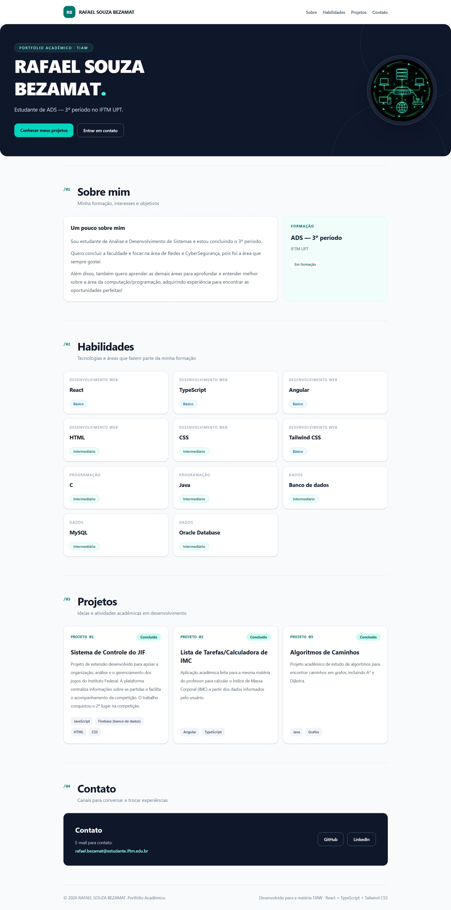

# Portfólio — Rafael Souza Bezamat

Portfólio pessoal (SPA) desenvolvido para a disciplina de
**Tecnologias para Interfaces de Aplicações Web**, curso **ADS — 3º período, IFTM UPT**.

## Tecnologias

React 19, TypeScript, Vite 8 e Tailwind CSS 4.

## Instalação e execução

- `Passo 01 -` Utilize o comando: npm install.
- `Passo 02 -` Depois de instalar o projeto, utilize o comando: npm run dev.
- `Passo 03 -` Após isso o projeto será executado e vai gear localhost/link para você acessar o site.
- `Passo 04 -` Acessando o link você vai conseguir visualizar o projeto!

## Captura de tela

## Componentes

- `Cabecalho`: identidade visual, apresentação e links de navegação.
- `Painel`: seção reutilizável com `children` tipado como `ReactNode`.
- `Sobre`: apresentação pessoal e formação.
- `ListaHabilidades`: habilidades renderizadas com `map` e chave estável.
- `GradeProjetos`: lista de projetos.
- `CardProjeto`: projeto individual, com renderização condicional de status e repositório.
- `Contato`: endereço de e-mail exibido como texto e links profissionais.
- `Rodape`: autoria, créditos e ano.

`src/data/portifolioData.ts` guarda os dados e `src/types/portfolio.ts` define a tipagem.
